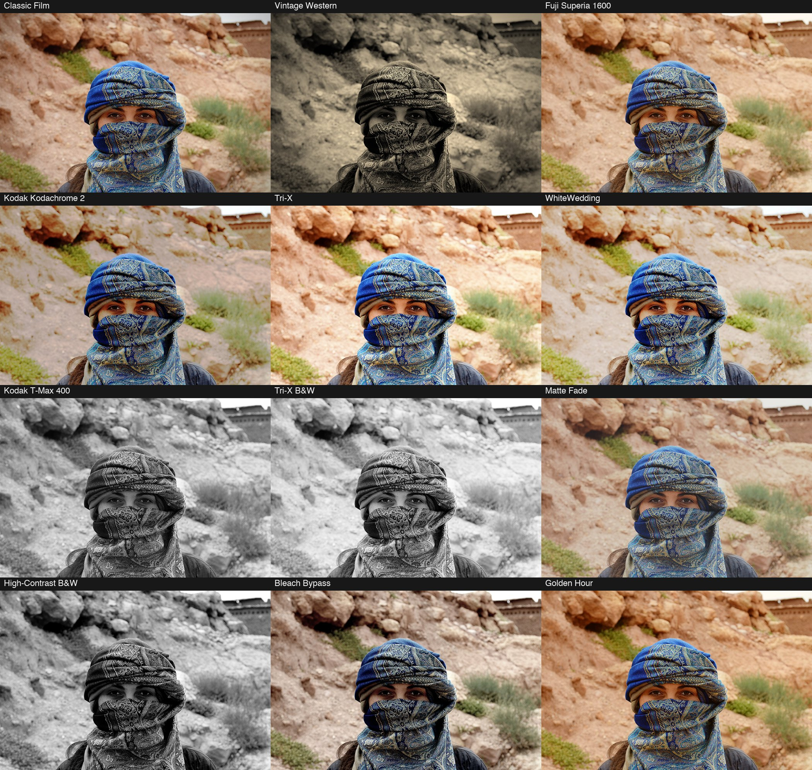

# ODC Film Look

A free, open source filter plug-in for [PhotoCraft](https://opendesignercloud.com): **11 film looks** (Kodachrome, Tri-X, Fuji Superia, bleach bypass and more) plus **film grain, vignette, faded blacks and warmth**, in one dialog. It is a single 12 KB WebAssembly file, so the same `odc-film-look.wasm` works on macOS, Windows, Linux and the web build.



Photo: Open Designer Cloud Stock Photos, https://opendesignercloud.com/stock/photos/ (royalty free). The original is `examples/original.jpg`.

## Install

1. Download `dist/odc-film-look.wasm` (or build it, below).
2. In PhotoCraft choose **Filter > Plug-ins > Install Plug-in...** and pick the file. Or put it in a folder and set **Edit > Preferences > Plug-ins > Additional Plug-ins Folder** (turn on *Use Additional Plug-ins Folder*): every `.wasm` in that folder loads at startup.
3. Run it from **Filter > Plug-ins > ODC Film Look...**. It has a live preview, works on the selection, and is one undo step.

From a script or the control port: `plugin.install` with `{"path": "odc-film-look.wasm"}` (or `{"data": "<base64>"}`), then `plugin.run` with `{"id": "org.opendesignercloud.film-look", "params": {...}}`.

## The looks

The looks are the presets from the Adjust Color tool in HyperImage (levels, gamma, exposure, contrast, highlights, shadows, vibrance, saturation, temperature, tint, sepia, a tone curve and a split tone), ported to run inside PhotoCraft's sandbox. The tests run HyperImage's own code and require the plug-in to match it within rounding (0.5 of a level) for every look.

| Look | What it is |
|---|---|
| Classic Film | Light grain, a soft vignette and slightly faded blacks. The default. |
| Custom | Starts from nothing: only the sliders you move do anything. |
| Vintage Western | Sepia, low-key, held highlights, fine grain, strong vignette. |
| Fuji Superia 1600 | Lifted shadows, warm cast, the FUJI-SUPERIA Picture Control curve. |
| Kodak Kodachrome 2 | Rich color with the Kodachrome curve. |
| Tri-X | The Tri-X Picture Control curve in color. |
| WhiteWedding | A bright, airy curve. |
| Kodak T-Max 400 | Black and white with a yellow filter. |
| Tri-X B&W | Black and white with the Tri-X curve. |
| Matte Fade | Curve-lifted blacks and cool shadows. |
| High-Contrast B&W | Punchy black and white. |
| Bleach Bypass | Desaturated, high contrast, silvery. |
| Golden Hour | Warm temperature, more vibrance, open shadows. |

**Not ported:** HyperImage's corrective presets (Interior / Real Estate, Twilight Exterior, Overcast Day, Backlit Rescue, Product on White, Web Punch, Soft Portrait, Clarity Punch, Noise Reduction) because they depend on local contrast, sharpening, texture or noise reduction, which look at neighbouring pixels. The same goes for the Depth, Sharpness and Texture settings inside the looks above (Vintage Western, Fuji Superia 1600 and T-Max 400 are just a little less crisp than in HyperImage).

## Controls

Pick a **look**, then fine-tune. **The sliders are adjustments added to the look, so 0 means "as the look is"** (a look's own grain, vignette and fade are the starting point of those sliders). With **Custom** every amount starts at 0, so a grain of 25 gives grain 25.

| Control | Range | What it does |
|---|---|---|
| look | list | The starting point. |
| strength | 0 to 100 (100) | Mixes the whole result with the original. |
| grain | -100 to 100 | Grain strength. Strongest in the midtones. Negative values remove the look's grain. |
| grainSize | -7 to 7 | Grain size in pixels (the result is kept between 1 and 8). |
| grainColor | -100 to 100 | 0 = monochrome grain, 100 = independent grain per color channel. |
| vignette | -100 to 100 | How much the corners darken. |
| vignetteSize, vignetteFeather, vignetteRound | -100 to 100 | How far it reaches, how soft the edge is, and how circular it is (0 follows the photo's shape). |
| fade | -100 to 100 | Lifts the blacks for a faded print look. |
| warmth | -100 to 100 | Negative is cooler (more blue), positive is warmer (more orange). |
| seed | 0 to 9999 | Different seed, different grain pattern. |

Order of the steps: the look, fade, warmth, vignette, grain. Works on RGB and grayscale documents (8, 16 or 32 bit), leaves alpha alone, and skips fully transparent pixels. CMYK, Lab and multichannel documents are refused with an error (the document is left untouched).

The grain and the vignette are calculated from each pixel's position in the document, not from random numbers: the result has no seams where PhotoCraft cuts a large layer into bands, and the same settings with the same seed always give the same pixels.

## Your own presets

PhotoCraft plug-ins run in a sandbox with no storage, and the plug-in dialog has no preset menu (yet), so a preset cannot be saved from inside the dialog. Presets are therefore kept in a small file and managed with a command line tool (Python 3, nothing to install):

```sh
python3 tools/film_look_presets.py list
python3 tools/film_look_presets.py add "Dusty Kodachrome" --from "Kodak Kodachrome 2" grain=20 vignette=15 warmth=10
python3 tools/film_look_presets.py edit "Dusty Kodachrome" grain=35 seed=4
python3 tools/film_look_presets.py apply "Dusty Kodachrome" photo.jpg photo-dusty.jpg
python3 tools/film_look_presets.py delete "Dusty Kodachrome"
```

`apply` runs the preset on any picture through `photocraft-cli` (also over a folder with a shell loop). To use the same values in the dialog, `show "Dusty Kodachrome"` prints them. Presets are saved in `~/.config/odc-film-look/presets.json` (set `ODC_FILM_LOOK_PRESETS` to move it). The 13 built-in looks cannot be edited or deleted; make your own copy with `add NAME --from LOOK`.

A preset menu inside the dialog (save, rename, delete) needs a small change to PhotoCraft itself, because only the app can store settings. This plug-in's parameter names are ready for it.

## Build

```sh
rustup target add wasm32-unknown-unknown   # once
./build.sh                                  # writes dist/odc-film-look.wasm
```

`no_std` Rust, no dependencies, no allocator, no imports (as the PhotoCraft sandbox requires). The source is one file, `src/lib.rs`, written to be read: a small example of the PhotoCraft plug-in ABI v1 with a manifest, a choice parameter, tables built per run and position-aware effects.

## Test

```sh
python3 test/test_film_look.py [photo.jpg]
```

Needs `numpy`, `Pillow`, `node` and `photocraft-cli` (installed with PhotoCraft; set `PHOTOCRAFT_CLI` if it is elsewhere). It installs the plug-in and checks, through the real app engine: identity with every effect off, fade, warmth and vignette against a reference formula, every look against HyperImage's own code (`test/reference.js`, copied from HyperImage), strength, repeatable grain per seed, grain strength following the slider, no seams at band edges, and that the preset tool matches the plug-in's manifest. Tested with PhotoCraft 0.20.1.

## Ideas for a next version

* Halation (a soft red glow around highlights) and the local-contrast, sharpening and texture steps (they look at neighbouring pixels, so `overlap` up to 256 px).
* Presets inside the dialog (needs a PhotoCraft change).

## License

Apache License 2.0 (see `LICENSE` and `NOTICE`). Contributions welcome; unless you say otherwise, a contribution you submit is licensed under the same terms.
