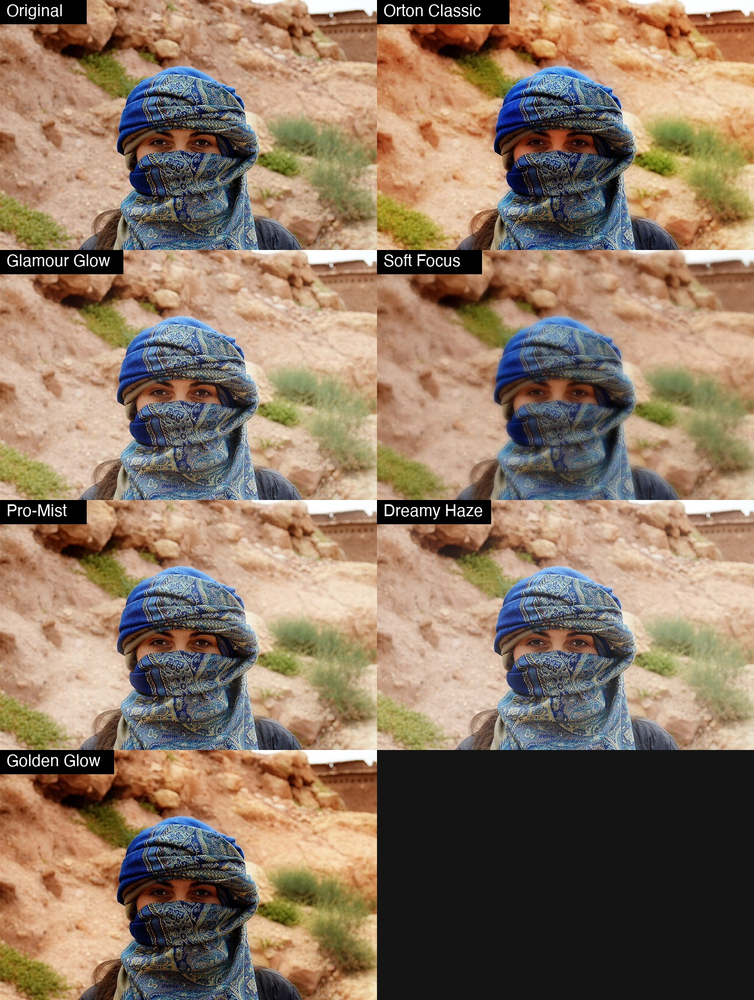

# ODC Glow

A free, open source filter plug-in for [PhotoCraft](https://opendesignercloud.com) for **glow, haze and soft focus**: the Orton effect, glamour glow, soft focus, Pro-Mist style highlight bloom, dreamy haze and golden glow, with **six looks** to start from. It is a single 10 KB WebAssembly file, so the same `odc-glow.wasm` works on macOS, Windows, Linux and the web build.



Photo: Open Designer Cloud Stock Photos, https://opendesignercloud.com/stock/photos/ (royalty free). The original is `examples/original.jpg`.

## Install

1. Download `dist/odc-glow.wasm` (or build it, below).
2. In PhotoCraft choose **Filter > Plug-ins > Install Plug-in...** and pick the file. That install lasts for the session. To have it every time, copy the `.wasm` into one folder (not its project folder: the folder is not searched recursively) and set **Edit > Preferences > Plug-ins > Additional Plug-ins Folder** to it, with *Use Additional Plug-ins Folder* on.
3. Run it from **Filter > Plug-ins > ODC Glow...**. It has a live preview, works on the selection, and is one undo step.

From a script or the control port: `plugin.install` with `{"path": "odc-glow.wasm"}`, then `plugin.run` with `{"id": "org.opendesignercloud.glow", "params": {...}}`.

## How it works

The picture is blurred (only its bright parts when a threshold is set). The blur is graded (brightness, contrast, saturation, warmth) and blended over the sharp picture with Screen, Soft Light, Overlay, Lighten or Normal. Less of it lands in the shadows when they are protected.

## The looks

| Look | Blend | What it is |
|---|---|---|
| Orton Classic | Overlay | A contrasty, saturated blur laid over the sharp picture. The default. |
| Custom | Screen | Starts from nothing: only the sliders you move do anything (set `amount`). |
| Glamour Glow | Screen | A soft, bright, slightly warm veil that keeps the shadows clean. Portraits. |
| Soft Focus | Normal | The picture mixed with a softer copy of itself. |
| Pro-Mist | Screen | Highlights spill into their surroundings, like a Black Pro-Mist filter. |
| Dreamy Haze | Screen | A wide, cool, low-contrast haze. |
| Golden Glow | Soft Light | Warm light bleeding out of the highlights. |

## Controls

Pick a **look**, then fine-tune. **The sliders are adjustments added to the look, so 0 means "as the look is".** With **Custom** every amount starts at 0, so `amount` 50 gives glow 50.

| Control | Range | What it does |
|---|---|---|
| look | list | The starting point. |
| strength | 0 to 100 (100) | Mixes the whole result with the original. |
| blend | list | *As the look*, or force Screen, Soft Light, Overlay, Lighten or Normal. |
| radius | -100 to 100 | How far the glow spreads (a look's radius is in thousandths of the short side, so it scales with the photo). |
| amount | -100 to 100 | How much glow is blended in. At 0 nothing happens. |
| threshold | -100 to 100 | Only brighter areas glow (higher = fewer, brighter areas). |
| contrast | -100 to 100 | Contrast of the glow. Negative is flatter and hazier. |
| saturation | -100 to 100 | Colour of the glow. |
| warmth | -100 to 100 | Negative is cooler (blue), positive is warmer (orange). |
| brightness | -100 to 100 | Brightness of the glow. |
| protect | -100 to 100 | Keeps the glow out of the shadows, so blacks stay clean. |

Works on RGB and grayscale documents (8, 16 or 32 bit), leaves alpha alone. CMYK, Lab and multichannel documents are refused with an error (the document is left untouched).

## Limits

PhotoCraft gives a sandboxed plug-in at most **256 px of context** around each tile and **60 seconds** for the whole run.

* **The largest radius is about 85 px.** On a photo more than about 2800 px on the short side the *radius* slider tops out before it reaches 120 (a 4000 px photo caps at about 2% of the short side). The glow is then a little tighter than on a small copy of the same photo.
* **Blurs above 8 px are done at reduced resolution.** A blur that wide is smooth, so the result is within a level or two of the exact blur (largest difference at sharp edges: a few levels).
* **Speed.** On an 8-core Mac: 1.4 MP in under a second, 5 MP in about 9 s, 10 MP in about 15 s, 24 MP (6000 x 4000) in about 40 s. A slower machine with fewer cores may exceed the 60 seconds on the biggest photos; PhotoCraft then stops the run and leaves the document untouched.

## Your own presets

PhotoCraft plug-ins run in a sandbox with no storage, and the plug-in dialog has no preset menu (yet), so a preset cannot be saved from inside the dialog. Presets are kept in a small file and managed with a command line tool (Python 3, nothing to install):

```sh
python3 tools/glow_presets.py list
python3 tools/glow_presets.py add "Soft Skin" --from "Glamour Glow" blend="Soft Light" amount=20 radius=5
python3 tools/glow_presets.py edit "Soft Skin" amount=30
python3 tools/glow_presets.py apply "Soft Skin" photo.jpg photo-soft.jpg
python3 tools/glow_presets.py delete "Soft Skin"
```

`apply` runs the preset on any picture through `photocraft-cli`. `show "Soft Skin"` prints the values to type into the dialog. Presets are saved in `~/.config/odc-glow/presets.json` (set `ODC_GLOW_PRESETS` to move it). The built-in looks cannot be edited or deleted; make your own copy with `add NAME --from LOOK`.

## Build

```sh
rustup target add wasm32-unknown-unknown   # once
./build.sh                                  # writes dist/odc-glow.wasm
python3 test/test_glow.py                   # needs numpy, Pillow and photocraft-cli
```

`no_std` Rust with no dependencies. There is no glow tool in HyperImage to compare with, so `test/test_glow.py` carries an independent numpy implementation of the same formulas with an exact blur, and checks every blend, every control and every look against it (within half a level for blurs up to 8 px), and that a large photo cut into bands by PhotoCraft has no seams.

## License

Apache License 2.0 (see `LICENSE` and `NOTICE`). Contributions welcome; unless you say otherwise, a contribution you submit is licensed under the same terms.
