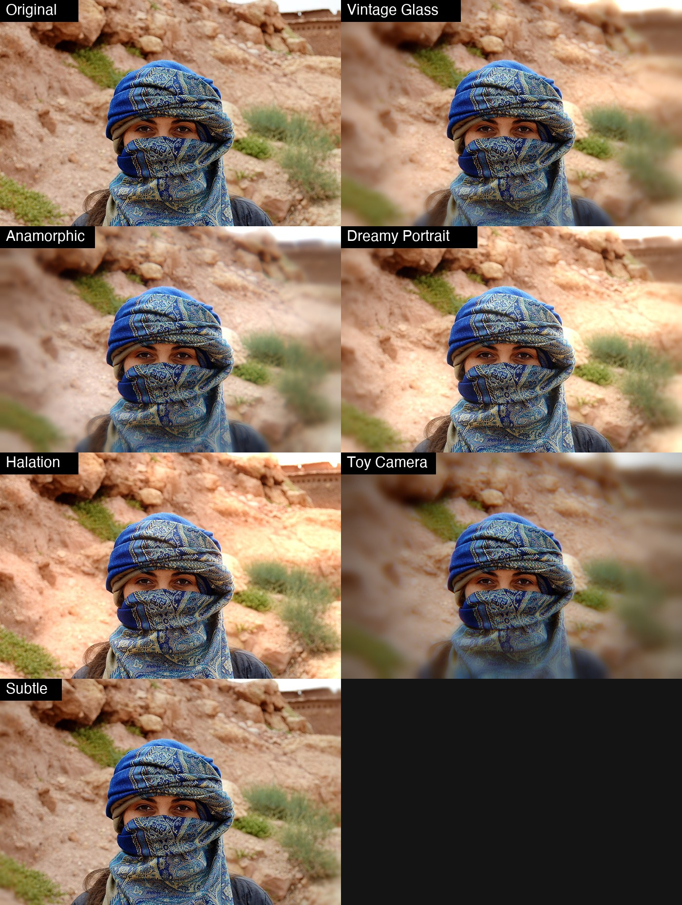

# ODC Lens

A free, open source filter plug-in for [PhotoCraft](https://opendesignercloud.com) that adds what real glass does to a picture and a perfect lens does not: **soft corners, colour fringes, bloom and halation, barrel distortion and vignette**, with **six looks** to start from. It is a single 12 KB WebAssembly file, so the same `odc-lens.wasm` works on macOS, Windows, Linux and the web build.



Photo: Open Designer Cloud Stock Photos, https://opendesignercloud.com/stock/photos/ (royalty free). The original is `examples/original.jpg`.

## Install

1. Download `dist/odc-lens.wasm` (or build it, below).
2. In PhotoCraft choose **Filter > Plug-ins > Install Plug-in...** and pick the file. That install lasts for the session. To have it every time, put the file in a folder and set **Edit > Preferences > Plug-ins > Additional Plug-ins Folder** (turn on *Use Additional Plug-ins Folder*): every `.wasm` in that folder loads at startup.
3. Run it from **Filter > Plug-ins > ODC Lens...**. It has a live preview, works on the selection, and is one undo step.

From a script or the control port: `plugin.install` with `{"path": "odc-lens.wasm"}`, then `plugin.run` with `{"id": "org.opendesignercloud.lens", "params": {...}}`.

## The looks

The effects, their order and the six looks are ported from the Lens tool in HyperImage. The tests run HyperImage's own code and require this plug-in to match it within half a level for each effect.

| Look | What it is |
|---|---|
| Vintage Glass | Soft corners, warm bloom, a little colour fringing, light vignette. The default. |
| Custom | Starts from nothing: only the sliders you move do anything. |
| Anamorphic | Blue bloom, strong fringing, a touch of barrel distortion. |
| Dreamy Portrait | A sharp centre, soft surroundings, warm glow. |
| Halation | Only the orange glow around bright areas. |
| Toy Camera | Heavy distortion, soft corners, strong fringes and vignette. |
| Subtle | A hint of everything. |

## Controls

Pick a **look**, then fine-tune. **The sliders are adjustments added to the look, so 0 means "as the look is".** With **Custom** every amount starts at 0, so `bloom` 50 gives bloom 50.

| Control | Range | What it does |
|---|---|---|
| look | list | The starting point. |
| strength | 0 to 100 (100) | Mixes the whole result with the original. |
| distortion | -100 to 100 | Positive is barrel (bulges outward), negative is pincushion. |
| caLateral | -100 to 100 | Lateral chromatic aberration: red and blue fringes that grow toward the corners. |
| softness | -100 to 100 | How blurry the corners get. |
| softStart | -100 to 100 | How far from the centre the softness begins (smaller = sooner). |
| caLong | -100 to 100 | Longitudinal chromatic aberration: which colour defocuses first. Needs softness above 0. |
| bloom | -100 to 100 | How much the bright areas glow. |
| bloomRadius | -100 to 100 | How far the glow spreads. |
| bloomThreshold | -100 to 100 | Brightness above which things glow (lower = more glows). |
| bloomHue, bloomTint | -180 to 180, -100 to 100 | Colour of the glow: hue in degrees, and how coloured it is (0 = white). |
| vignette | -100 to 100 | How much the corners darken. |

The dialog has no colour picker, so the HyperImage glow colour is held as hue and tint. All six HyperImage glow colours convert exactly.

Order of the steps: distortion and lateral fringes, then soft corners with longitudinal fringes, bloom, vignette. Works on RGB and grayscale documents (8, 16 or 32 bit), leaves alpha alone. CMYK, Lab and multichannel documents are refused with an error (the document is left untouched).

## Differences from HyperImage

* **Bloom is taken from the distorted picture, not from the softened one.** HyperImage blurs first and then blooms what is left; here both start from the same picture and are then added. A sandbox filter can only look 256 px around each pixel, and doing it in HyperImage's order would double the reach. On the example photo the mean difference is 1.5 levels (of 255), and the glow looks the same.
* **The HyperImage bug where longitudinal fringes did nothing at softness 0 is kept** (they need soft corners to exist).
* **Big radii are blurred at reduced resolution** (above 8 px). The blur is smooth, so this is within a level or two of the exact one, and it is what makes it affordable in the sandbox.

## Limits (read this for big photos)

PhotoCraft gives a sandboxed plug-in at most **256 px of context** around each tile and **60 seconds** for the whole run. That decides what is possible:

* **Distortion and lateral fringes** can move a pixel by at most 72 px. On a photo up to about 2000 px on the short side nothing is limited; on a bigger one, extreme distortion is scaled back to fit. Distortion is the one HyperImage effect that cannot be done in full on large photos in this sandbox. PhotoCraft's own *Filter > Lens Correction* is there for geometry.
* **Blur radii** (softness and bloom) are limited to what is left of the 256 px, about 60 px or more.
* **Speed.** Measured on an 8-core Mac: 1.4 MP in about 2 s, 5 MP in 20 to 26 s, 10 MP in 38 to 53 s. **A 24 MP photo (6000 x 4000) does not finish in 60 s and PhotoCraft stops it with "plug-in exceeded its time budget"; the document is left untouched.** Work on a reduced copy, or run it on a selection.

## Your own presets

PhotoCraft plug-ins run in a sandbox with no storage, and the plug-in dialog has no preset menu (yet), so a preset cannot be saved from inside the dialog. Presets are kept in a small file and managed with a command line tool (Python 3, nothing to install):

```sh
python3 tools/lens_presets.py list
python3 tools/lens_presets.py add "Soft Glow" --from "Dreamy Portrait" bloom=10 vignette=-5
python3 tools/lens_presets.py edit "Soft Glow" bloom=20
python3 tools/lens_presets.py apply "Soft Glow" photo.jpg photo-glow.jpg
python3 tools/lens_presets.py delete "Soft Glow"
```

`apply` runs the preset on any picture through `photocraft-cli`. `show "Soft Glow"` prints the values to type into the dialog. Presets are saved in `~/.config/odc-lens/presets.json` (set `ODC_LENS_PRESETS` to move it). The built-in looks cannot be edited or deleted; make your own copy with `add NAME --from LOOK`.

## Build

```sh
rustup target add wasm32-unknown-unknown   # once
./build.sh                                  # writes dist/odc-lens.wasm
python3 test/test_lens.py                   # needs node, numpy, Pillow and photocraft-cli
```

`no_std` Rust with no dependencies. `test/reference.js` is HyperImage's own Lens code, copied verbatim; the test compares every effect with it, and checks that a large photo cut into bands by PhotoCraft has no seams.

## License

Apache License 2.0 (see `LICENSE` and `NOTICE`). Contributions welcome; unless you say otherwise, a contribution you submit is licensed under the same terms.
