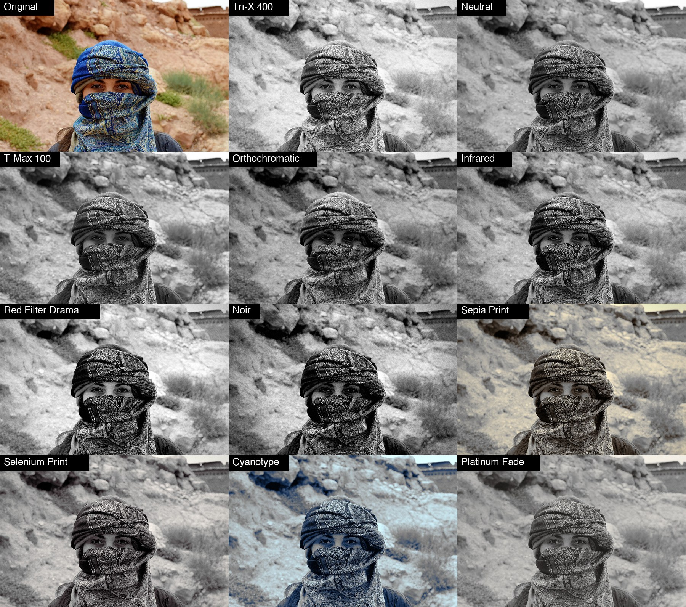

# ODC Mono

A free, open source filter plug-in for [PhotoCraft](https://opendesignercloud.com) for **black and white the way film does it**: the colours are converted with the **spectral response of a film stock**, optionally through a **colour filter** (a red filter turns a blue sky black), then given a tone curve, faded blacks, **split toning** (sepia, selenium, cyanotype, platinum), a vignette and **film grain**. **Eleven looks**, one 12 KB WebAssembly file, so the same `odc-mono.wasm` works on macOS, Windows, Linux and the web build.



Photo: Open Designer Cloud Stock Photos, https://opendesignercloud.com/stock/photos/ (royalty free). The original is `examples/original.jpg`.

## Install

1. Download `dist/odc-mono.wasm` (or build it, below).
2. In PhotoCraft choose **Filter > Plug-ins > Install Plug-in...** and pick the file. That install lasts for the session. To have it every time, copy the `.wasm` into one folder (not its project folder: the folder is not searched recursively) and set **Edit > Preferences > Plug-ins > Additional Plug-ins Folder** to it, with *Use Additional Plug-ins Folder* on.
3. Run it from **Filter > Plug-ins > ODC Mono...**. It has a live preview, works on the selection, and is one undo step.

From a script or the control port: `plugin.install` with `{"path": "odc-mono.wasm"}`, then `plugin.run` with `{"id": "org.opendesignercloud.mono", "params": {...}}`.

## Why not just use Black & White?

PhotoCraft's own *Image > Adjustments > Black & White* has six colour sliders and a tint, and it is a good tool. ODC Mono is the same idea as one named starting point per film look: a stock's colour response and tone curve, a filter you pick from a list instead of six sliders, toning with separate shadow and highlight colours, and grain that belongs to the picture's pixels. Use whichever you prefer; Mono is quicker when you want "Tri-X with a red filter" rather than a set of numbers.

## The looks

The Tri-X and T-Max tone curves are the ones of HyperImage's Tri-X and Kodak T-Max looks. The colour weights of each stock are **approximations** written for this plug-in, not measurements of the real emulsions.

| Look | What it is |
|---|---|
| Tri-X 400 | Classic press-film look: the Tri-X curve, coarse grain, a light vignette. The default. |
| Custom | Starts from nothing: plain luma grey, every amount at 0. |
| Neutral | Plain luma grey with no curve or grain. |
| T-Max 100 | Fine grain, the T-Max curve, cleaner tones. |
| Orthochromatic | Blind to red: lips and red brick go dark, blue skies go pale. |
| Infrared | Foliage glows white, blue skies go black. |
| Red Filter Drama | A red filter on Tri-X: black skies, bright clouds, hard contrast. |
| Noir | Deep blacks, hard contrast, heavy grain, strong vignette. |
| Sepia Print | A warm brown darkroom print. |
| Selenium Print | Cool purple-brown shadows over neutral highlights. |
| Cyanotype | Prussian blue shadows fading to pale blue highlights. |
| Platinum Fade | Soft, lifted blacks, a trace of warm tone, very fine grain. |

## Controls

Pick a **look**, then fine-tune. **The sliders are adjustments added to the look, so 0 means "as the look is".** With **Custom** every amount starts at 0, so `grain` 25 gives grain 25.

| Control | Range | What it does |
|---|---|---|
| look | list | The starting point (the stock's colour response, curve, filter, toning, grain, vignette). |
| strength | 0 to 100 (100) | Mixes the whole result with the original colour picture. |
| filter | list | *As the look*, or None, Yellow, Orange, Red, Green, Blue. A filter lightens its own colour and darkens the opposite one; neutral greys never change. |
| filterStrength | -100 to 100 | How strong the filter is (a look's own filters start at full strength). |
| exposure, contrast | -100 to 100 | Brighter or darker, and contrast around mid grey. |
| highlights, shadows | -100 to 100 | Positive opens that end of the range, negative pulls it back. |
| fade | -100 to 100 | Lifts the blacks for a faded print look. |
| toneAmount | -100 to 100 | How much of the look's shadow and highlight colours is mixed in. Greys stay grey at 0. |
| toneBalance | -100 to 100 | Where shadow colour gives way to highlight colour. |
| shadowHue, highlightHue | -180 to 180 | Turns the toning colours around the colour wheel (degrees). |
| grain, grainSize | -100 to 100, -7 to 7 | Amount and size of the film grain (monochrome, strongest in the midtones). |
| vignette, vignetteSize | -100 to 100 | How much the corners darken, and how far it reaches. |
| seed | 0 to 9999 | Different seed, different grain pattern. |

Order of the steps: stock (weights through the filter), tone table (exposure, contrast, shadows and highlights, the stock's curve), fade, toning, vignette, grain. Works on RGB documents (8, 16 or 32 bit) and on grayscale ones (where the colour filter and toning have nothing to act on). Leaves alpha alone and skips fully transparent pixels. CMYK, Lab and multichannel documents are refused with an error (the document is left untouched).

Grain and vignette are calculated from each pixel's position in the document, not from random numbers: there are no seams where PhotoCraft cuts a large layer into bands, and the same settings with the same seed always give the same pixels.

## Speed

Everything is per pixel (no neighbours, no overlap), so it is the fastest of the ODC plug-ins: on an 8-core Mac a 24 MP photo (6000 x 4000) takes about 8 s, well inside PhotoCraft's 60 s limit for a plug-in.

## Your own presets

PhotoCraft plug-ins run in a sandbox with no storage, and the plug-in dialog has no preset menu (yet), so a preset cannot be saved from inside the dialog. Presets are kept in a small file and managed with a command line tool (Python 3, nothing to install):

```sh
python3 tools/mono_presets.py list
python3 tools/mono_presets.py add "Street" --from "Tri-X 400" filter=Yellow contrast=10 grain=10
python3 tools/mono_presets.py edit "Street" grain=20
python3 tools/mono_presets.py apply "Street" photo.jpg photo-street.jpg
python3 tools/mono_presets.py delete "Street"
```

`apply` runs the preset on any picture through `photocraft-cli`. `show "Street"` prints the values to type into the dialog. Presets are saved in `~/.config/odc-mono/presets.json` (set `ODC_MONO_PRESETS` to move it). The built-in looks cannot be edited or deleted; make your own copy with `add NAME --from LOOK`. In PhotoCraft you can also record a run of the plug-in in the Actions panel and replay it on other pictures.

## Build

```sh
rustup target add wasm32-unknown-unknown   # once
./build.sh                                  # writes dist/odc-mono.wasm
python3 test/test_mono.py                   # needs numpy, Pillow and photocraft-cli
```

`no_std` Rust with no dependencies. HyperImage has no black and white tool to compare with, so `test/test_mono.py` carries an independent numpy implementation of the pipeline and checks every filter, slider and look against it (within half a level), the vignette against its formula, the grain statistically (strength, repeatability, seams), and that the preset tool matches the plug-in's manifest.

## License

Apache License 2.0 (see `LICENSE` and `NOTICE`). Contributions welcome; unless you say otherwise, a contribution you submit is licensed under the same terms.
