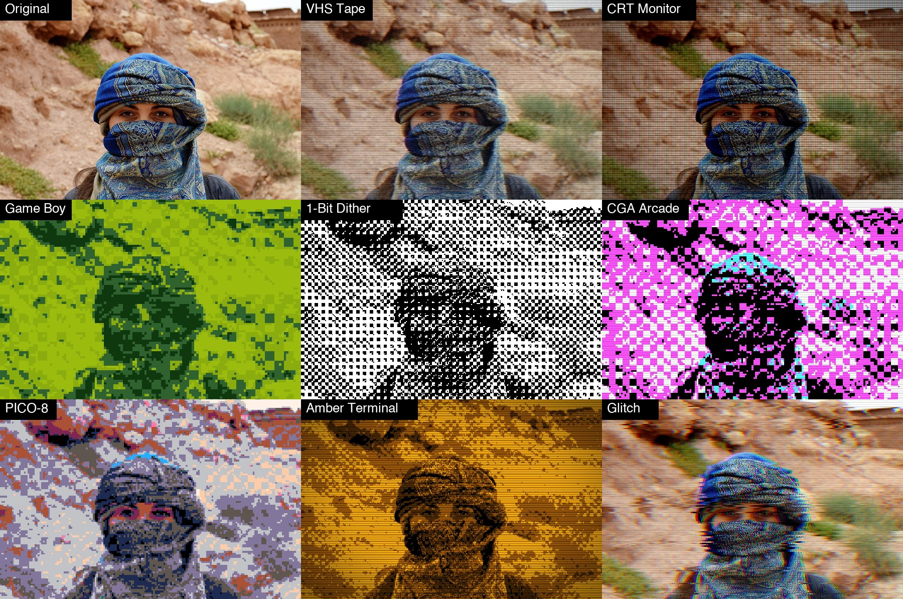

# ODC Retro

A free, open source filter plug-in for [PhotoCraft](https://opendesignercloud.com) for **old screens and old hardware**: **VHS** tape (colour smeared sideways, colour fringes, static, torn lines), **CRT** (scanlines, RGB phosphor mask, vignette), and **pixel art with a fixed palette and ordered dither** (Game Boy, 1-bit, CGA, PICO-8, amber and green terminals). **Eight looks**, one 12 KB WebAssembly file, so the same `odc-retro.wasm` works on macOS, Windows, Linux and the web build.



Photo: Open Designer Cloud Stock Photos, https://opendesignercloud.com/stock/photos/ (royalty free). The original is `examples/original.jpg`. (The contact sheet is shrunk with nearest-neighbour sampling, so thin scanlines look coarser than they do at full size.)

## Install

1. Download `dist/odc-retro.wasm` (or build it, below).
2. In PhotoCraft choose **Filter > Plug-ins > Install Plug-in...** and pick the file. That install lasts for the session. To have it every time, copy the `.wasm` into one folder (not its project folder: the folder is not searched recursively) and set **Edit > Preferences > Plug-ins > Additional Plug-ins Folder** to it, with *Use Additional Plug-ins Folder* on.
3. Run it from **Filter > Plug-ins > ODC Retro...**. It has a live preview, works on the selection, and is one undo step.

From a script or the control port: `plugin.install` with `{"path": "odc-retro.wasm"}`, then `plugin.run` with `{"id": "org.opendesignercloud.retro", "params": {...}}`.

## What PhotoCraft already has, and what this adds

PhotoCraft has Mosaic, Posterize, Color Halftone, Add Noise and Film Grain. What it does not have is **a fixed colour palette with ordered dither** (so a photo becomes a real Game Boy or CGA picture), a **glitch** effect, or a **VHS/CRT** look in one step. That is what this plug-in is for.

## The looks

| Look | What it is |
|---|---|
| VHS Tape | Colour smeared sideways, colour fringes, static, a little glitch, washed out. The default. |
| Custom | Starts from nothing: only the sliders you move do anything. |
| CRT Monitor | Scanlines, an RGB phosphor mask, punchy colour, a curved-glass vignette. |
| Game Boy | Four greens, 8 pixel blocks, ordered dither. |
| 1-Bit Dither | Black and white pixels only, the classic Mac look. |
| CGA Arcade | The cyan, magenta, white and black CGA palette, with scanlines. |
| PICO-8 | The 16 PICO-8 colours, light dither. |
| Amber Terminal | A monochrome amber terminal: scanlines, static, vignette. |
| Glitch | Broken colour channels, torn lines, static. |

## Controls

Pick a **look**, then fine-tune. **The sliders are adjustments added to the look, so 0 means "as the look is".** With **Custom** every amount starts at 0, so `scanlines` 40 gives scanlines 40. Sizes are relative to the picture (thousandths of its long or short side), so a look has the same character on a small photo and a large one.

| Control | Range | What it does |
|---|---|---|
| look | list | The starting point. |
| strength | 0 to 100 (100) | Mixes the whole result with the original. |
| palette | list | *As the look*, or None, Game Boy, 1-Bit, Grayscale 4, CGA Cyan Magenta, CGA Red Green, PICO-8, Amber Terminal, Green Phosphor. Every pixel becomes the nearest palette colour. |
| pixelSize | -20 to 20 | Size of the big pixels (up to 32 px). 0 is no pixelation. |
| dither | -100 to 100 | How much ordered (Bayer 8 x 8) dither is mixed in before the palette is applied, so gradients turn into patterns instead of bands. |
| scanlines, lineSize | -100 to 100, -3 to 3 | Dark lines every few pixels, and how far apart they are. |
| phosphor | -100 to 100 | A red / green / blue column mask like a CRT's shadow mask. |
| colorSmear | -100 to 100 | Colour (not brightness) smeared sideways, up to 24 px, like a VHS tape. |
| colorSplit | -100 to 100 | Red and blue slide apart horizontally, up to 16 px. |
| glitch | -100 to 100 | Bands of rows slide sideways (up to 48 px). More amount: more bands, further. |
| static | -100 to 100 | Static, one value per big pixel. |
| saturation, contrast | -100 to 100 | Colour and contrast, before the palette is applied. |
| vignette | -100 to 100 | Darkens the corners. |
| seed | 0 to 9999 | Different seed, different static and glitch pattern. |

Order of the steps: pixelate, glitch bands, RGB split, colour smear, saturation and contrast, static, palette with dither, scanlines and phosphor mask, vignette. **RGB documents only** (8, 16 or 32 bit): a grayscale, CMYK or Lab document is refused with an error and left untouched. Alpha is left alone and fully transparent pixels are skipped.

Pixel blocks, glitch bands, scanlines, the phosphor mask and the dither matrix are all aligned to the picture (not to the pieces PhotoCraft cuts a big layer into), so there are no seams, and the same settings with the same seed always give the same pixels.

## Limits

PhotoCraft gives a sandboxed plug-in at most **256 px of context** and **60 seconds** for the whole run. ODC Retro asks for 128 px, which covers the biggest reach it can have (pixel block 32 + glitch shift 48 + colour split 16 + colour smear 24 = 120 px). Nothing is ever scaled back. Speed on an 8-core Mac: 5 MP in 2 to 5 s; **24 MP (6000 x 4000) in 11 to 20 s**, comfortably inside the limit.

## Your own presets

PhotoCraft plug-ins run in a sandbox with no storage, and the plug-in dialog has no preset menu (yet), so a preset cannot be saved from inside the dialog. Presets are kept in a small file and managed with a command line tool (Python 3, nothing to install):

```sh
python3 tools/retro_presets.py list
python3 tools/retro_presets.py add "Handheld" --from "Game Boy" dither=40 scanlines=15
python3 tools/retro_presets.py edit "Handheld" pixelSize=2
python3 tools/retro_presets.py apply "Handheld" photo.jpg photo-handheld.jpg
python3 tools/retro_presets.py delete "Handheld"
```

`apply` runs the preset on any picture through `photocraft-cli`. `show "Handheld"` prints the values to type into the dialog. Presets are saved in `~/.config/odc-retro/presets.json` (set `ODC_RETRO_PRESETS` to move it). The built-in looks cannot be edited or deleted; make your own copy with `add NAME --from LOOK`. In PhotoCraft you can also record a run of the plug-in in the Actions panel and replay it on other pictures.

## Build

```sh
rustup target add wasm32-unknown-unknown   # once
./build.sh                                  # writes dist/odc-retro.wasm
python3 test/test_retro.py                  # needs numpy, Pillow and photocraft-cli
```

`no_std` Rust with no dependencies. There is nothing in HyperImage to compare with, so `test/test_retro.py` carries an independent numpy implementation of the whole pipeline and checks every effect, every palette and every look against it. The palettes match to the pixel; where a pixel sits exactly between two palette colours a handful may differ, so the tests allow 0.2 % of pixels to. It also checks that a large photo cut into bands by PhotoCraft has no seams, and that the preset tool matches the plug-in's manifest.

## License

Apache License 2.0 (see `LICENSE` and `NOTICE`). Contributions welcome; unless you say otherwise, a contribution you submit is licensed under the same terms.
