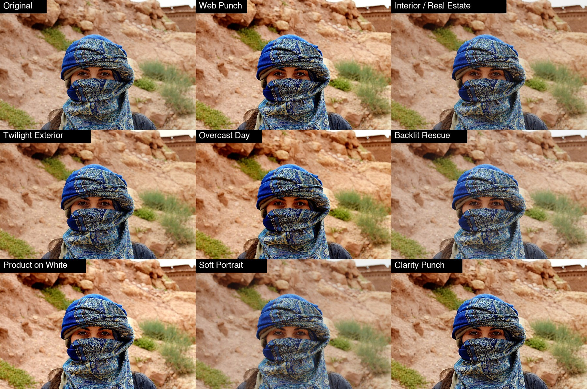

# ODC Tone

A free, open source filter plug-in for [PhotoCraft](https://opendesignercloud.com) that fixes a picture's light: **pull back a bright window, open the shadows, add local contrast, texture and sharpness**, with **eight corrective looks** (interiors and real estate, twilight exteriors, overcast days, backlit subjects, products on white, soft portraits, web export, heavy clarity). It is a single 13 KB WebAssembly file, so the same `odc-tone.wasm` works on macOS, Windows, Linux and the web build.



Photo: Open Designer Cloud Stock Photos, https://opendesignercloud.com/stock/photos/ (royalty free). The original is `examples/original.jpg`.

## Install

1. Download `dist/odc-tone.wasm` (or build it, below).
2. In PhotoCraft choose **Filter > Plug-ins > Install Plug-in...** and pick the file. That install lasts for the session. To have it every time, copy the `.wasm` into one folder (not its project folder: the folder is not searched recursively) and set **Edit > Preferences > Plug-ins > Additional Plug-ins Folder** to it, with *Use Additional Plug-ins Folder* on.
3. Run it from **Filter > Plug-ins > ODC Tone...**. It has a live preview, works on the selection, and is one undo step.

From a script or the control port: `plugin.install` with `{"path": "odc-tone.wasm"}`, then `plugin.run` with `{"id": "org.opendesignercloud.tone", "params": {...}}`.

## What it is, and how it relates to Camera Raw

This is the corrective half of HyperImage's Adjust Color tool: the tone and colour sliders, then three steps that look at neighbouring pixels. The looks, the formulas and the order are ported from HyperImage, and the tests run HyperImage's own code and require this plug-in to match it within half a level.

PhotoCraft's own **Camera Raw** filter (Filter > Camera Raw) already has Texture, Clarity and Dehaze sliders, and so overlaps with the sliders here. What ODC Tone adds is a **one-click starting point for each common problem**, HyperImage's own *Depth* local contrast, and the same look in HyperImage and PhotoCraft.

Order of the steps: the grade (exposure, contrast, highlights, shadows, black and white point, vibrance, saturation, temperature, tint, split tone), then **Local contrast**, then **Sharpness**, then **Texture**. The grade is clamped before the spatial steps, as in HyperImage's 8-bit path.

## The looks

| Look | What it is for |
|---|---|
| Web Punch | A finishing pass before export: contrast, vibrance, local contrast and sharpness that survive being viewed small. The default. |
| Custom | Starts from nothing: only the sliders you move do anything. |
| Interior / Real Estate | A window three stops brighter than the room: highlights back, shadows open, then contrast. |
| Twilight Exterior | Opens the building without draining the sky: blue shadows, warm windows. |
| Overcast Day | Flat grey light: gives it a black point and some warmth. |
| Backlit Rescue | A subject against a bright window or sky: a big shadow lift, highlights held down. |
| Product on White | A white sweep: a lower white point forces a near-white background to actually reach white. |
| Soft Portrait | Smooths skin at the medium scale while sharpness keeps lashes and hair crisp. |
| Clarity Punch | Heavy local contrast for architecture and detail. Strong: back *localContrast* off if halos appear along rooflines. |

**Not ported:** HyperImage's Noise Reduction look, because it needs HyperImage's despeckle and noise-reduction passes (not part of this plug-in). Its stylistic looks are in ODC Film Look.

## Controls

Pick a **look**, then fine-tune. **The sliders are adjustments added to the look, so 0 means "as the look is".** With **Custom** every amount starts at 0.

| Control | Range | What it does |
|---|---|---|
| look | list | The starting point. |
| strength | 0 to 100 (100) | Mixes the whole result with the original. |
| exposure | -100 to 100 | Brighter or darker (in hundredths of a stop). |
| contrast | -100 to 100 | Contrast around mid gray. |
| highlights | -100 to 100 | Negative pulls the bright end back, positive brightens it. |
| shadows | -100 to 100 | Positive opens the dark end, negative deepens it. |
| blackPoint, whitePoint | -100 to 100 | Moves where black and white sit (in levels). A lower white point forces near-white to white. |
| vibrance | -100 to 100 | Boosts muted colours more than saturated ones, and skin tones less. |
| saturation | -100 to 100 | All colours. |
| temperature, tint | -100 to 100 | Blue to orange, and green to magenta. |
| splitTone | -100 to 100 | How much of the look's shadow and highlight colours is mixed in (only some looks have colours). |
| localContrast | -100 to 100 | HyperImage's *Depth*: lifts regions that are broadly bright and deepens broadly dark ones. |
| sharpness | -100 to 100 | An unsharp mask at 1 px radius. |
| texture | -100 to 100 | Medium-scale detail: positive restores surface character, negative smooths skin. |

Works on RGB and grayscale documents (8, 16 or 32 bit), leaves alpha alone. CMYK, Lab and multichannel documents are refused with an error (the document is left untouched). The local-contrast and texture radii scale with the photo (2% and 0.6% of its long side), so a thumbnail and a large export look alike.

## Limits

PhotoCraft gives a sandboxed plug-in at most **256 px of context** around each tile and **60 seconds** for the whole run.

* **Reach.** Local contrast, sharpness and texture run one after another, so their radii add up: on a photo wider than about 9000 px they are scaled back together to fit. Below that nothing is limited.
* **The wide local-contrast blur is done at reduced resolution** above a 40 px radius (photos wider than about 2000 px). It is smooth, so the difference is small: against HyperImage's exact blur on a 2800 px photo the largest difference was 2 levels and the mean 0.27.
* **Speed.** On an 8-core Mac with the heaviest look (Clarity Punch): 1.4 MP in about 2 s, 5 MP in 8 s, 11 MP in 19 s. **A 24 MP photo (6000 x 4000) takes 57 to 59 s, too close to the 60 s limit to rely on:** on a slower machine PhotoCraft will stop it with "plug-in exceeded its time budget" and leave the document untouched. Work on a reduced copy or a selection for photos that large.

## Your own presets

PhotoCraft plug-ins run in a sandbox with no storage, and the plug-in dialog has no preset menu (yet), so a preset cannot be saved from inside the dialog. Presets are kept in a small file and managed with a command line tool (Python 3, nothing to install):

```sh
python3 tools/tone_presets.py list
python3 tools/tone_presets.py add "Listing" --from "Interior / Real Estate" shadows=10 sharpness=-5
python3 tools/tone_presets.py edit "Listing" shadows=15
python3 tools/tone_presets.py apply "Listing" photo.jpg photo-listing.jpg
python3 tools/tone_presets.py delete "Listing"
```

`apply` runs the preset on any picture through `photocraft-cli`. `show "Listing"` prints the values to type into the dialog. Presets are saved in `~/.config/odc-tone/presets.json` (set `ODC_TONE_PRESETS` to move it). The built-in looks cannot be edited or deleted; make your own copy with `add NAME --from LOOK`.

## Build

```sh
rustup target add wasm32-unknown-unknown   # once
./build.sh                                  # writes dist/odc-tone.wasm
python3 test/test_tone.py                   # needs node, numpy, Pillow and photocraft-cli
```

`no_std` Rust with no dependencies. `test/reference.js` is HyperImage's grading plus its Depth, Sharpness and Texture code, copied verbatim; the test compares every step and every look with it, and checks that a large photo cut into bands by PhotoCraft has no seams.

## License

Apache License 2.0 (see `LICENSE` and `NOTICE`). Contributions welcome; unless you say otherwise, a contribution you submit is licensed under the same terms.
